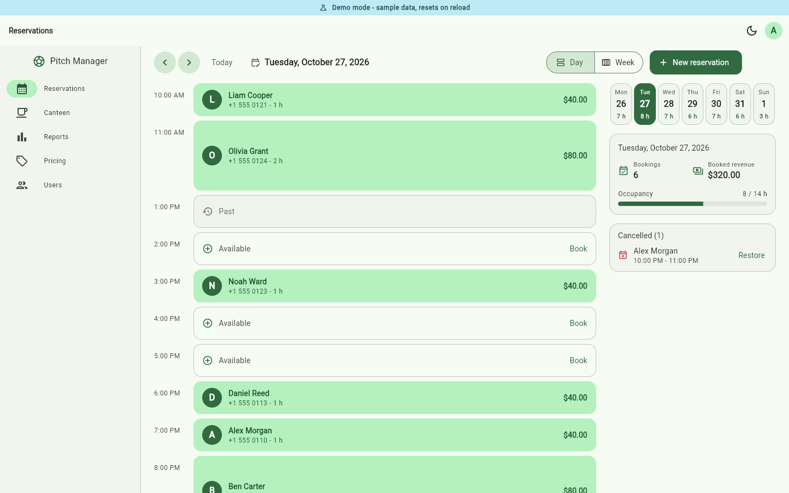
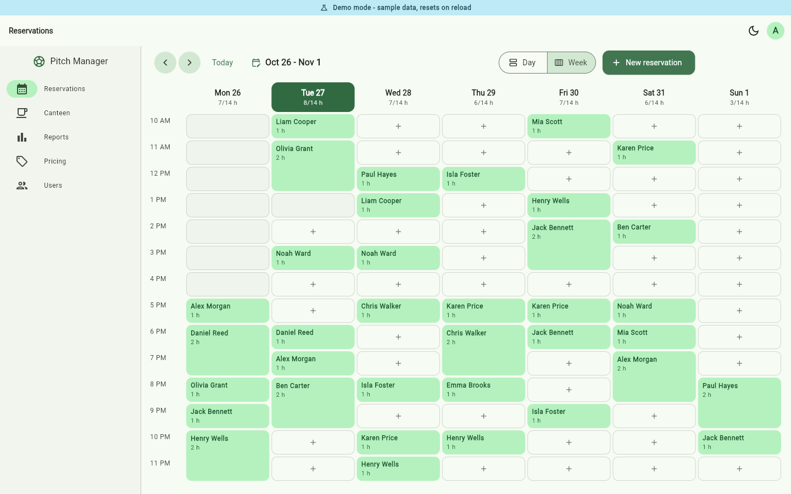
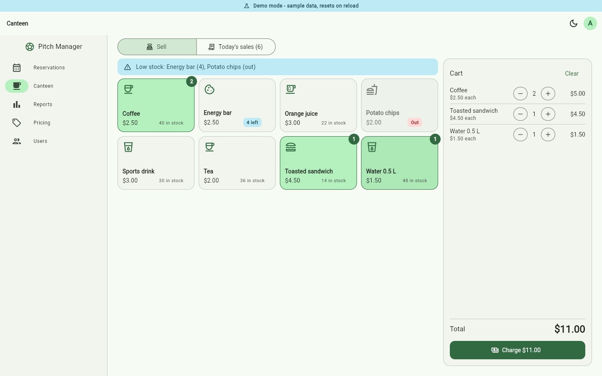
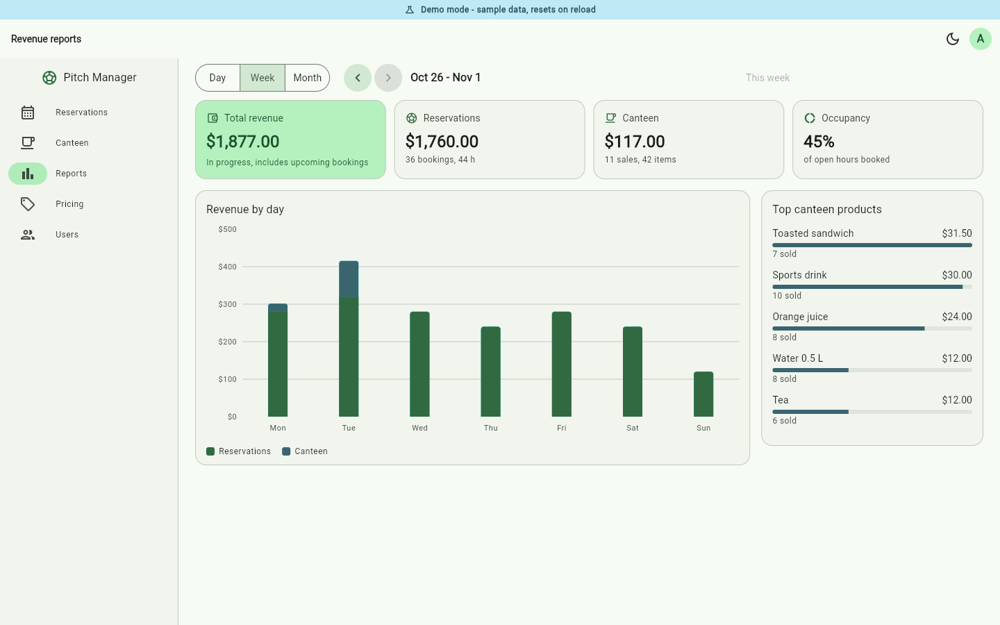
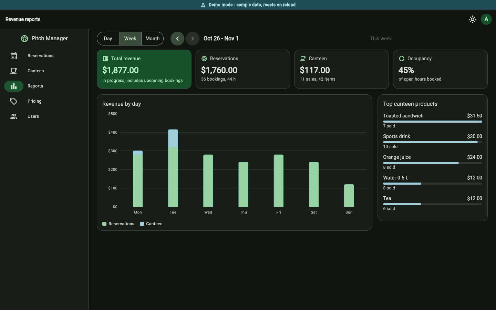
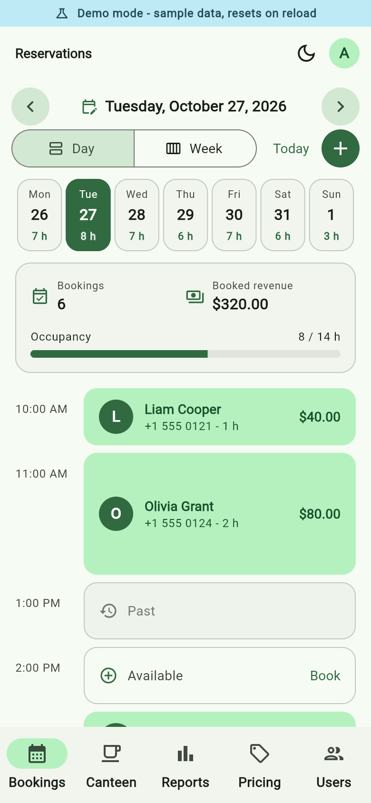

# Pitch Manager

Reservations, canteen sales and revenue reports for a small football pitch, built with **Flutter** (Material 3, light and dark) on **Firebase Auth + Cloud Firestore**.

**[Live demo](https://vaas125.github.io/football-pitch-booking/)** - runs entirely in the browser with sample data, no sign-up needed (use the demo accounts shown on the login screen; the password is `demo1234`).



| Week calendar | Canteen point of sale |
| --- | --- |
|  |  |

| Revenue reports | Dark theme | Phone |
| --- | --- | --- |
|  |  |  |

## Features

**Reservations**
- Day view with hourly slots and a week strip, plus a 7-day calendar grid
- Booking form: start time, duration (1-3 hours), customer name and phone, live price preview
- Double-booking is rejected (in Firestore with per-hour lock documents written in the same transaction)
- Cancel with confirmation, **undo** right after booking or cancelling, and restore cancelled bookings
- Prices are fixed when a reservation is made, so changing the hourly rate never rewrites history

**Canteen point of sale**
- Product tiles with stock levels, low-stock and out-of-stock warnings, a cart with quantity controls
- Checkout decrements stock atomically and can be undone; sales can be voided later (stock is returned)
- Today's sales list with totals

**Revenue reports (admin)**
- Day (by hour), week and month (by day) with a stacked bar chart of reservation and canteen revenue
- KPIs: total, reservations, canteen, occupancy; comparison with the previous period once a period has ended
- Top canteen products

**Roles**
- **Admin**: everything above plus pricing (hourly rate, product prices and stock), user management and reports
- **Staff**: reservations and canteen sales only

**Quality**
- Responsive layout: bottom navigation on phones, navigation rail on tablets and desktop
- Loading, empty and error states with retry; form validation; confirmation dialogs for destructive actions
- Semantics labels for slots, chart summaries, KPIs and buttons (works with screen readers)
- English UI, USD currency and `en_US` date formats via `intl`

## Architecture

```
lib/
  main.dart                    Chooses demo or Firebase repositories and starts the app
  app/                         MaterialApp, auth gate, themes, theme mode
  core/
    config/                    Build flags (DEMO_MODE) and business constants (opening hours, ...)
    models/                    Reservation, Product, Sale, AppUser
    repositories/              Interfaces: Auth, Reservation, Canteen, Settings
    data/
      firebase/                Firestore / Firebase Auth implementations
      demo/                    In-memory implementations and the deterministic seed data
    domain/                    RevenueCalculator (pure functions)
    state/                     ChangeNotifier controllers (Provider)
    utils/                     Date helpers and formatters
  features/                    auth, shell (navigation), reservations, canteen, reports, admin
  shared/widgets/              Loading / empty / error views, demo banner
test/                          Unit and widget tests
scripts/build_demo.ps1         Builds the GitHub Pages demo into docs/
firestore.rules                Security rules (role aware)
```

Screens talk only to controllers, and controllers only to the repository interfaces in `core/repositories`. `main.dart` decides which implementation to inject, which is what makes the Firebase-free demo possible without any `if (demo)` checks in the UI.

### Firestore data model

| Collection | Document | Notes |
| --- | --- | --- |
| `users/{uid}` | `email`, `role` (`admin`/`staff`), `displayName` | A signed-in account without a profile has no access |
| `settings/general` | `hourlyRate` | |
| `products/{id}` | `name`, `price`, `stock` | |
| `reservations/{id}` | `start`, `hours`, `customerName`, `customerPhone`, `price`, `status`, `createdBy` | Queried by `start` range (no composite index needed) |
| `slotLocks/{startMillis}` | `reservationId` | One per booked hour; written transactionally to prevent double bookings |
| `sales/{id}` | `soldAt`, `soldBy`, `voided`, `lines[]` | Never deleted, only voided |

`firestore.rules` enforces the roles: only admins manage users, settings and products; staff can create reservations, change a reservation's `status`, record sales, void a sale (`voided` only) and decrement product `stock`.

## Run the demo (no Firebase needed)

```bash
flutter pub get
flutter run -d chrome --dart-define=DEMO_MODE=true
```

Demo mode skips Firebase initialisation, seeds a few weeks of reservations, canteen products and sales history relative to today, and shows a "Demo mode" banner. Everything lives in memory and resets when the page reloads.

| Account | Role | Password |
| --- | --- | --- |
| `admin@pitch.test` | Admin | `demo1234` |
| `staff@pitch.test` | Staff | `demo1234` |

## Run with Firebase

**Prerequisites:** [Flutter](https://docs.flutter.dev/get-started/install) (stable, Dart 3.10+) and a Firebase project.

1. **Install dependencies:** `flutter pub get`
2. **Connect your project.** `lib/firebase_options.dart` is committed with placeholders so the code compiles without credentials. Generate your own:

   ```bash
   dart pub global activate flutterfire_cli
   flutterfire configure
   ```

3. **In the Firebase console** enable *Authentication > Email/Password* and create a *Cloud Firestore* database, then deploy the rules:

   ```bash
   firebase deploy --only firestore
   ```

4. **Create the first administrator.** Add a user under *Authentication*, then create a document `users/<that user's UID>` in Firestore:

   ```json
   { "email": "you@example.com", "role": "admin", "displayName": "Admin" }
   ```

   From then on, sign in and add staff accounts on the *Users* screen. (New accounts are created through a secondary Firebase app instance so the administrator stays signed in.)

5. **Start the app:** `flutter run -d chrome` (or any other device). The canteen starts empty; add products on the *Pricing* screen.

Notes on removing users: the app deletes the user's profile document, which revokes all access (both the app and the security rules require it). Deleting the underlying Firebase Auth record needs the Firebase console or the Admin SDK.

## Tests

```bash
flutter analyze
flutter test
```

111 tests cover the revenue calculations, date helpers and formatters, the in-memory repositories (booking conflicts, cancel/restore, atomic checkout, voiding, auth), all controllers (reservations, canteen cart and checkout, reports, session, settings) and the main user flows as widget tests (login and roles, booking, cancel/undo, week view, POS, reports, pricing, users, phone layout, dark theme, demo banner). Measured with `flutter test --coverage`, the code the tests load is ~93% line-covered. The Firebase repository classes and `main.dart` are intentionally not part of that number: they need the Firebase emulator to be exercised.

## Rebuild the GitHub Pages demo

GitHub Pages serves the `main` branch from `/docs`, and the generated site is committed:

```powershell
./scripts/build_demo.ps1
```

This runs `flutter build web --release --dart-define=DEMO_MODE=true --base-href /football-pitch-booking/`, copies `build/web` into `docs/` (dropping renderer variants the JavaScript build does not use) and adds `.nojekyll`. Pass `-BaseHref /your-repo-name/` when publishing under another name. In the repository settings choose *Pages > Deploy from a branch > main / docs*.

## Known limitations

- Opening hours (10:00-24:00), the maximum reservation length (3 h) and the low-stock threshold are constants in `lib/core/config/app_config.dart`.
- All times are the local time of the device; there is a single pitch and a single currency (USD).
- The web build and the tests are what has been run and verified. The Android, iOS and desktop runner folders are standard Flutter scaffolding that has not been built.
- Firestore transactions, rules and the Firebase Auth flow are not exercised by automated tests (they need the Firebase emulator); the demo mode and the test suite cover the same app logic through the in-memory repositories.

## License

[MIT](LICENSE)
